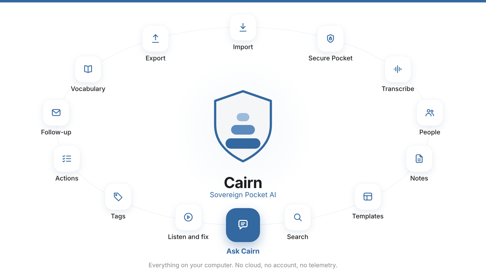
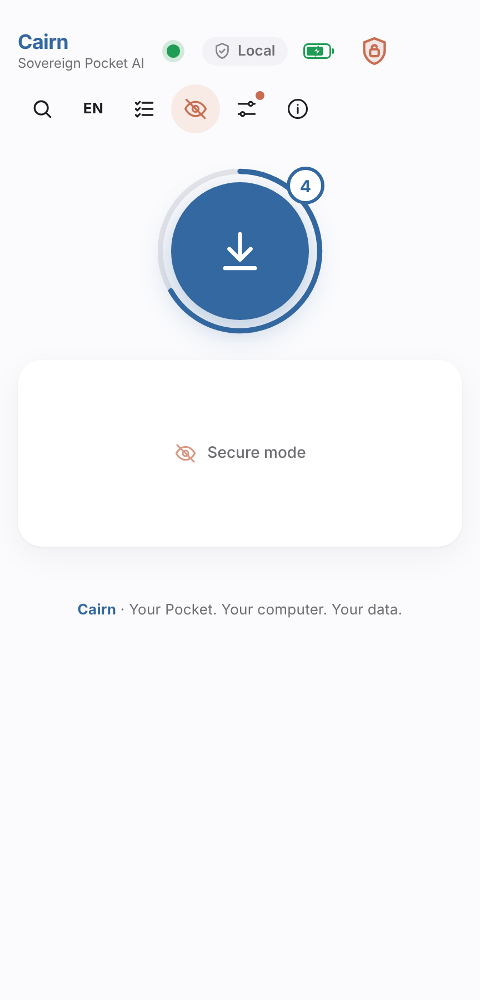
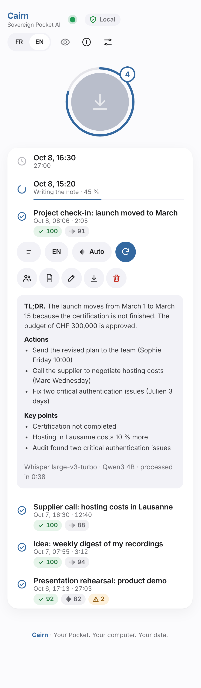
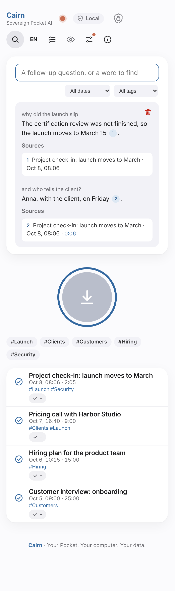

# Cairn

**Your Pocket. Your computer. Your data.**

Cairn turns your Pocket recordings into structured notes: transcribed, analysed and kept on your computer, and nowhere else. No cloud, no account, no telemetry.



## What it does

- **Capture.** Plug in your Pocket and every recording is copied and verified, or drop any audio file on the page. A password locks what stays on the Pocket; a lock seals notes and recordings on this computer.
- **Understand.** Whisper writes every word locally. Voices are named once and recognised in every note. Each note has a title, summary, decisions, actions and key points, in your own template, with a fidelity score.
- **Find and fix.** Search every word of every note, or ask a question and get the answer with its source. Tap a time stamp, hear the passage, fix the word. Tags replace folders.
- **Act.** All actions from all notes in one list, by person. The follow-up email is already written. Export to Markdown, HTML, text or email.

| Secure by default | Your notes | Ask your notes |
|---|---|---|
|  |  |  |
| **Hear and fix** | **All your actions** | **Your models** |
|  |  |  |

Every feature, step by step: [Guide](docs/GUIDE.md). What changed in each version: [Release notes](docs/RELEASE-NOTES.md).

> **Status: v0.8.0.** Runs in your browser, offline. Tested end to end on macOS (Apple silicon). Windows is checked in CI, not yet on real hardware. Intel Mac and Linux are untested.

## Install

Cairn installs in one folder of your home folder (`~/Cairn`): no administrator rights, nothing to install beforehand. Delete the folder to uninstall. Every download, with version and size: [SECURITY.md](SECURITY.md).

**macOS, disk image.** Download [Cairn.dmg](https://github.com/yanickimhof/cairn/releases/latest/download/Cairn.dmg) and double-click **Install Cairn**. The app is not signed with an Apple developer certificate, so macOS asks once (macOS 15: System Settings, Privacy & Security, **Open Anyway**; macOS 14: Control-click, Open).

**macOS, one command.**

```
curl --proto '=https' --tlsv1.2 -fsSL https://raw.githubusercontent.com/yanickimhof/cairn/v0.8.0/install.sh | bash
```

The installer reads your Mac and advises a set of models; Enter takes the advised one.

| Profile | Made for | Speech | Notes | Download |
|---|---|---|---|---|
| **Light** | 8 GB of memory | Whisper large-v3-turbo | Qwen3 4B | about 4.1 GB |
| **Standard** | 16 GB | Whisper large-v3-turbo | Qwen3 8B | about 6.8 GB |
| **High** | 32 GB or more | Whisper large-v3 | Qwen3 14B | about 12.4 GB |

**From a clone.** `git clone https://github.com/yanickimhof/cairn.git`, then `bash install.sh` (`.\install.ps1` on Windows). `git pull` and the same command update Cairn.

**Windows.** `irm https://raw.githubusercontent.com/yanickimhof/cairn/v0.8.0/install.ps1 | iex` installs the Light models; change them later in **Settings, Models**.

Requirements, options, update and troubleshooting: [docs/INSTALL.md](docs/INSTALL.md).

## Use it

1. Open `~/Cairn/Cairn.app` (macOS), the Start menu shortcut or `Cairn.cmd` (Windows), or run `~/Cairn/bin/cairn`. A page opens, served only by your computer.
2. Connect your Pocket ([one-time setup](docs/INSTALL.md#set-up-your-pocket-once)) or drop audio files on the page. Recordings are listed as waiting; you decide what to process.
3. Press the central button, or tap a recording. Cairn transcribes with Whisper, then titles and summarises with a local Qwen model, in the language and level of detail you choose.
4. Each note shows its fidelity to the transcript and the speech engine's confidence, and highlights passages worth checking. Rename, tag, export, or write the follow-up email.
5. The magnifier searches every note; press Enter to ask a question instead. The checklist icon gathers all your actions.
6. Deleting a recording removes it from the Pocket and from your computer, for good.

## Sovereign by design

- Audio, transcripts and summaries stay on your computer; the models are open and swappable.
- No outgoing connection in everyday use, apart from an optional daily look for a new version. A network guard blocks the rest, and a daily privacy check shows its result next to **Local**.
- The app and the model server answer only on `127.0.0.1`.
- Every change goes through automated tests, static analysis, a secrets scan and a full install on macOS and Windows. Packages are pinned by hash and models by revision. Details and known limits: [SECURITY.md](SECURITY.md).

How to verify it yourself: [docs/PRIVACY.md](docs/PRIVACY.md).

## Buying a Pocket

Cairn is free and works with any Pocket you already own. To buy one, use [heypocket.com](https://heypocket.com). The maintainer's [referral link](https://referral.heypocketai.com/refer/39179caf?source=desktop_copy) is optional: the offer is set by Pocket alone and can change or end at any time. If you use it, the maintainer receives a reward from Pocket at no cost to you.

## Disclaimer

Cairn is an independent, unofficial project, **not affiliated with, endorsed by or sponsored by Pocket** ([heypocket.com](https://heypocket.com)), a product of Open Vision Engineering Inc. "Pocket" and "Pocket AI" belong to their owners. Cairn uses these names only to say which device it works with and includes none of their logos or assets. Make sure you have the right, and the consent where required, to record and process conversations.

## License

MIT, see [LICENSE](LICENSE). Third-party components keep their own licenses, see [NOTICE](NOTICE). Copyright (c) 2026 Yanick Imhof.
