# Cairn

**Your Pocket. Your computer. Your data.**

**Sovereign Pocket AI.** Cairn turns your Pocket recordings into sharp, structured notes. Transcribed, analysed and kept on your computer, and nowhere else.

**No cloud. No account. No telemetry. Nothing leaves your machine.**

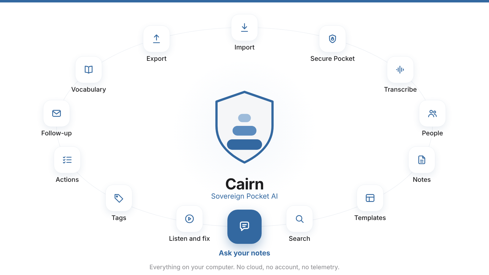

## What Cairn does

**Capture.** Plug in your Pocket and every recording is copied and verified, without a click. One password locks what stays on the Pocket.

**Understand.** Whisper writes every word on your machine, for one minute or four hours. Voices are named once and recognised in every note. Each note comes with a title, a summary, decisions, actions and key points, in the template you defined once, with a fidelity score that keeps the AI honest.

**Find and fix.** Any word in every note in a second, or ask your notes a question and get an answer with its source. Tap a time stamp, hear the passage, fix the word. Teach Cairn your names once and they are right in every note. Tags replace folders.

**Act.** Every action from every note, by person, in one list. The follow-up email is already written. Export to Markdown, HTML, text or email.

## Ask your notes

**Ask in your own words. Get the answer, and the minute it was said.**

Cairn answers from what was said in your recordings. Every statement points to the passage and the minute behind it. Follow up as in a conversation. Ask what is still open this week, or narrow a question to one tag. The model runs on your Mac, has no tool and no network, and nothing is kept.

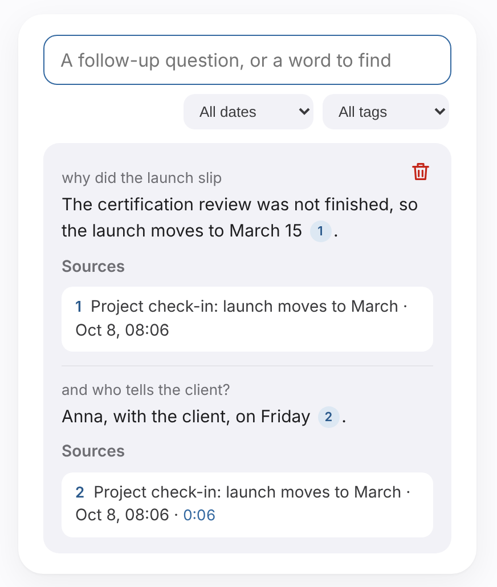

Optional, installed from Settings > Models. How it works: [docs/GUIDE.md](docs/GUIDE.md#finding-listening-following-up).

## Sovereign by design

Your recordings never leave your computer. No account, no cloud, no telemetry, and everything works offline. A vault encrypts what stays on the Pocket, a secure mode hides the screen, and you choose the models that run. You hold the keys.


What is new in each version: [Release notes](docs/RELEASE-NOTES.md).

| Secure by default | Your recordings | Your notes |
|---|---|---|
|  |  |  |

| Secure my Pocket | A Pocket that is protected | Who said what |
|---|---|---|
| 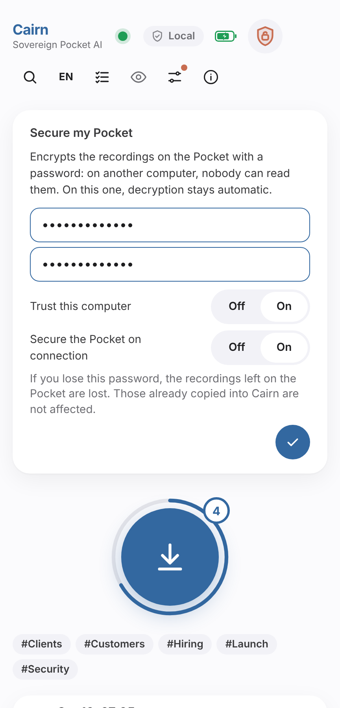 | 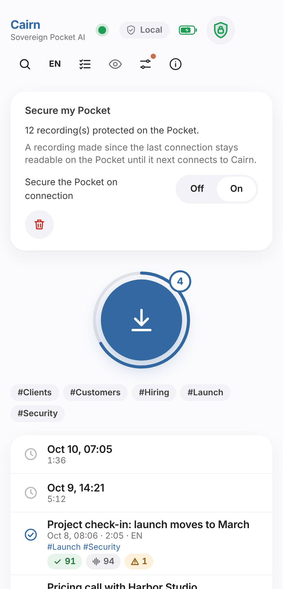 | 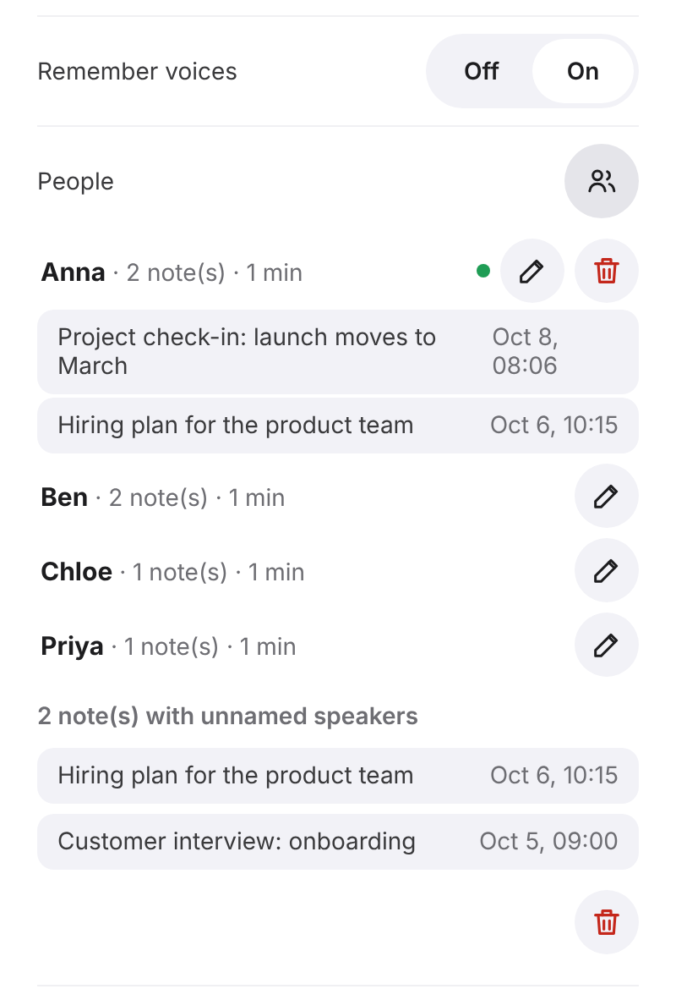 |

| Find anything | Ask your notes | Hear what was said |
|---|---|---|
| 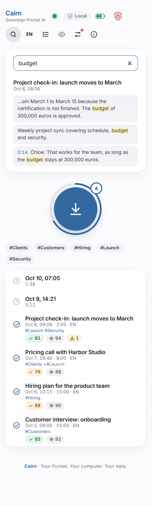 | 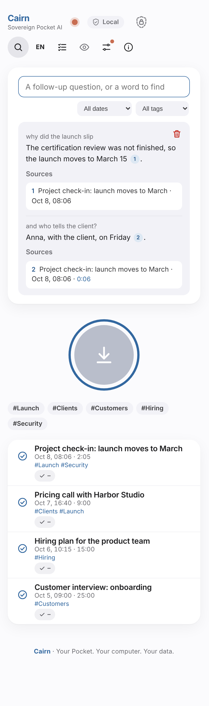 | 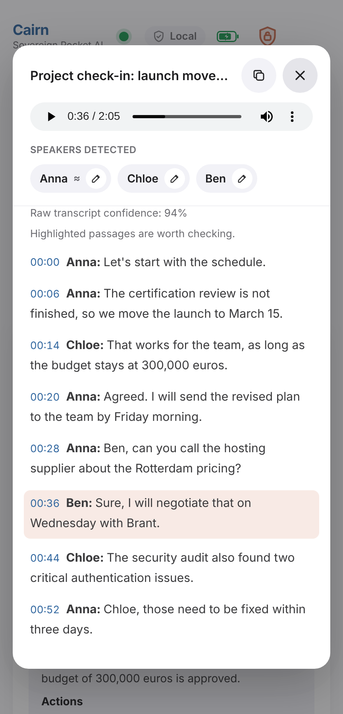 |

| Fix it in place | Words to check | Your vocabulary |
|---|---|---|
| 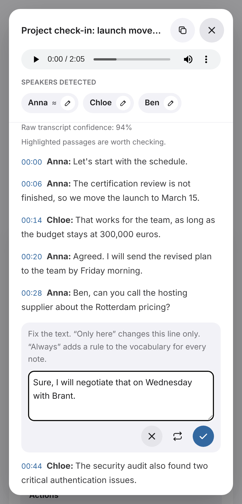 | 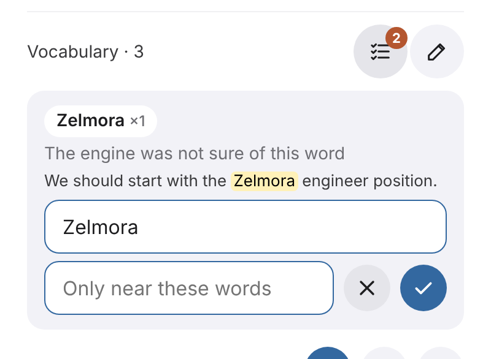 | 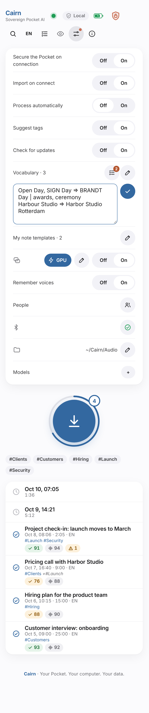 |

| Tags | All your actions | The follow-up email |
|---|---|---|
| 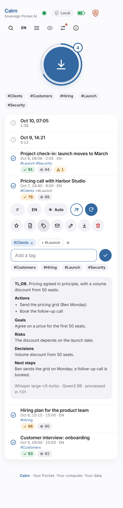 | 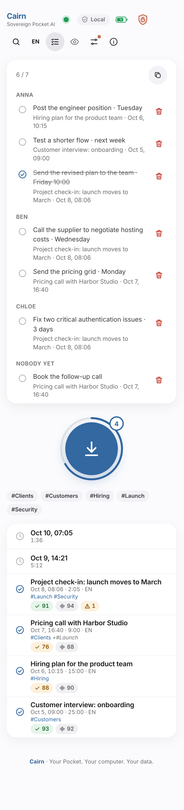 | 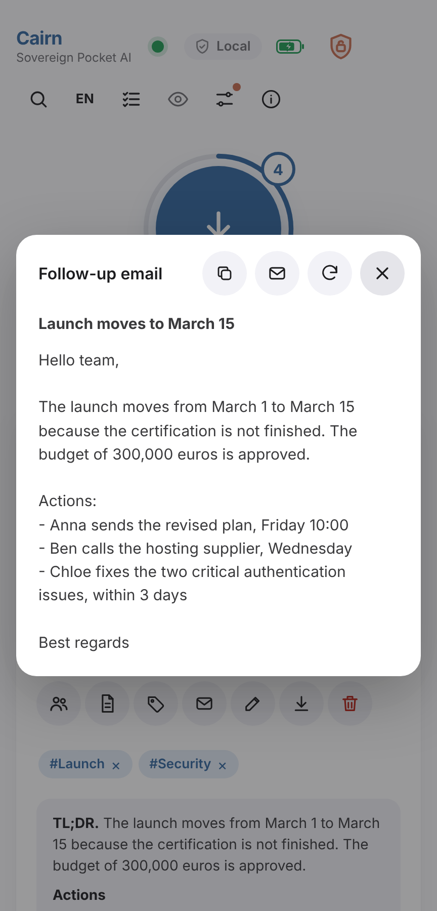 |

| Settings | Your note templates | Models on demand |
|---|---|---|
|  | 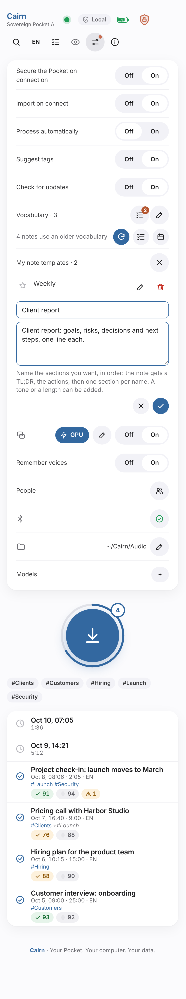 |  |

| About | Export to HTML (transcript folded) | Copy for an email |
|---|---|---|
|  |  |  |

> **Status: v0.6.0, stable.** Runs in your browser, offline. Tested end to end on macOS (Apple silicon); Windows is checked in CI, not yet on real hardware; Intel Mac and Linux are untested. See the [release notes](docs/RELEASE-NOTES.md).

## Install

Paste one command in a terminal. It detects your system and installs everything in your own folder: no administrator rights, no system change. Not sure which one? The [install page](https://yanickimhof.github.io/cairn_pocket_ai/) shows the right command and the download sizes.

bash or zsh:

```
curl --proto '=https' --tlsv1.2 -fsSL https://raw.githubusercontent.com/yanickimhof/cairn_pocket_ai/v0.6.0/install.sh | bash
```

PowerShell:

```
irm https://raw.githubusercontent.com/yanickimhof/cairn_pocket_ai/v0.6.0/install.ps1 | iex
```

| | Minimum | Recommended |
|---|---|---|
| Processor | 64-bit, 4 cores (Intel Mac or Windows PC: slower) | Apple silicon (M1 or later), or a recent 8-core PC |
| Memory | 8 GB | 16 GB or more (larger models) |
| Disk space | 12 GB free | 20 GB free |
| System | macOS 14, Windows 10 22H2 | Latest version |
| Internet | Installation only: about 5.5 GB (Mac) or 7 GB (Windows), about 2.5 GB if Ollama and a Qwen3 model are already installed | |

No graphics card needed. Everything works offline once installed.

## Set up your Pocket (once)

In the Pocket mobile app, open the device settings, then:

1. Turn **on** USB Mode (Pocket Web Sync). It is off by default, and the USB-C port then only charges.
2. Turn **off** every automatic or cloud sync option (auto-sync, Wi-Fi or online sync, cloud backup and the like). Otherwise the Pocket sends recordings to Pocket's online service on its own, and the phone app then removes them from the drive, so Cairn never sees them. Option names vary between app versions.
3. Connect the Pocket with a USB-C **data** cable. A drive named `Pocket` appears, and the dot in Cairn turns green. If no drive appears, see [troubleshooting](docs/INSTALL.md#troubleshooting): Cairn can only read a Pocket that the computer already shows as an external drive. Close the Pocket desktop app if you use it, so that only one program reads the device.

You need neither the Pocket desktop app nor a Pocket account on the computer.

> **Battery (macOS):** when it can read the Pocket over Bluetooth, Cairn shows a small battery next to the Local badge (read only, no pairing). The Pocket accepts one Bluetooth connection at a time, so nothing shows while the Pocket app on your phone is connected to it: closing the app is not enough: switch the phone to airplane mode (or turn its Bluetooth off), and the battery appears.

> **Pocket status (macOS, optional):** in Settings, you can enter your own Pocket session key to also see the firmware, device state and storage used, read only. This is not required and nothing is captured by Cairn for you: see [docs/GUIDE.md](docs/GUIDE.md#pocket-status-macos-optional) for what the key is and where it comes from.

> **Speaker identification (optional):** in Settings, add your Hugging Face token, install its model (Settings > Models), then switch it on to see who's speaking in the transcript and the note. Speakers can be given a real name from the transcript view, and an older recording can be rediarized on demand. Off by default, fully local once installed; see [docs/GUIDE.md](docs/GUIDE.md#speaker-identification-diarization-optional) for setup, including the Hugging Face access you need to accept once. On a Mac with Apple silicon it runs on the graphics chip by default, at least four times faster with the same result; Settings can switch it to the processor.

> **Names and places (optional):** in Settings, add the names of people and places and the rare terms you use to Vocabulary, one per line. Cairn writes close variants as listed in the transcript, tells the summary the spelling, and shows every correction on the note. `Brant, Brand => Brandt` always replaces each spelling, and `Open Day => BRANDT Day | awards, ceremony` only near those words. One tap then updates the notes that need it.

> **Ask your notes (optional):** in Settings > Models, install a search model (Qwen3 Embedding 0.6B, 0.6 GB, or BGE-M3, 1.2 GB, many languages). Your notes are indexed in the background, then a question typed in the magnifier and sent with Enter is answered by your summary model from the passages it finds, each with its number, note and minute. Follow-ups, "what is still open?", and a period or a tag to narrow the question are all there; the model has no tool, nothing is stored and nothing leaves your computer. Details: [docs/GUIDE.md](docs/GUIDE.md#finding-listening-following-up).

> **Choose your models (optional):** the default install uses Whisper large-v3-turbo and Qwen3 4B. In Settings > Models you can switch the speech model to Whisper large-v3 (3.1 GB, slower, 16 GB of memory advised) and the summary model to Qwen3 8B or 14B. Nothing downloads until you confirm, and a model already in your Ollama is reused. Sizes shown for installed models are the real ones on your computer.

## Use it

1. Start Cairn: open `~/Cairn/Cairn.app` (macOS), the Start menu shortcut or `Cairn.cmd` (Windows), or run `~/Cairn/bin/cairn`. A page opens, served only by your computer and protected by a session key.
2. Connect your Pocket. Cairn copies and verifies the new recordings and lists them as waiting, so you see everything and decide what to process.
3. Press the central button (its badge counts what is waiting) to process the queue, or tap one recording. Cairn transcribes with Whisper, then titles and summarizes with a local model (a Qwen model through Ollama), at the level of detail, in the language and with the type you choose for each recording. Settings can import and process by themselves.
4. Each note shows two indicators, the fidelity of the note to its transcript and the speech engine's confidence in the raw transcript, and highlights the passages worth checking. Rename, tag, copy or export it (Markdown, HTML, to `~/Cairn/Exports`), tap a time stamp to hear the recording from that line, or write the follow-up email.
5. The magnifier searches every note (`#tag` filters). Press Enter to ask a question instead: the answer comes with the passages it is drawn from. The checklist icon gathers all your actions in one list.
6. Delete a recording when you no longer want it: it goes from the Pocket and from your computer in one step, for good, because the Pocket has no protection of its own.

Models, speed, background mode, web app and other details: [docs/GUIDE.md](docs/GUIDE.md). Install options, update and troubleshooting: [docs/INSTALL.md](docs/INSTALL.md).

## How it is checked

Every change runs through automated checks on GitHub: unit and end-to-end tests, a test that loads and drives the page script, static analysis of the code, a scan for secrets, and a complete installation on macOS and Windows, from a simulated Pocket to an exported note. The install commands point at a fixed release, packages are pinned by hash, speech models by revision, and Dependabot watches the dependencies. The interface goes through automated accessibility checks (axe-core) and a keyboard walk; it has not been tested with a screen reader yet. Details and known limits: [SECURITY.md](SECURITY.md).

## Why sovereign

- Audio, transcripts and summaries stay on your computer, and the models are open and swappable.
- No outgoing connection in everyday use, apart from an optional daily look for a new version. A network guard blocks the rest, and a privacy check runs by itself every day: the shield next to **Local** shows the result.
- Nothing is reachable from the network: the app and the model server answer only on `127.0.0.1`, your computer talking to itself.

How to verify it yourself: [docs/PRIVACY.md](docs/PRIVACY.md). Every download, with versions and sizes: [SECURITY.md](SECURITY.md).

## Buying a Pocket

Cairn is free and works with any Pocket you already own. To buy one, use the official site, [heypocket.com](https://heypocket.com). The maintainer's [referral link](https://referral.heypocketai.com/refer/39179caf?source=desktop_copy) is optional: it is Pocket's own programme, so the offer (10% off at the time of writing) is set by Pocket alone and can change or end at any time. If you use it, the maintainer receives a reward from Pocket at no cost to you. Cairn works the same either way.

## Disclaimer

Cairn is an independent, unofficial project, **not affiliated with, endorsed by or sponsored by Pocket** ([heypocket.com](https://heypocket.com)), a product of Open Vision Engineering Inc. "Pocket" and "Pocket AI" belong to their owners. Cairn uses these names only to say which device it works with, includes none of their logos or assets, and reads the files the device exposes in USB mode.

Make sure you have the right, and the consent where required, to record and process conversations.

## License

MIT, see [LICENSE](LICENSE). Third-party components keep their own licenses, see [NOTICE](NOTICE). Copyright (c) 2026 Yanick Imhof.
