# Cairn

**Your Pocket. Your computer. Your data.**

**Sovereign Pocket AI.** Cairn turns your Pocket recordings into sharp, structured notes. Transcribed, analysed and kept on your computer, and nowhere else.

**No cloud. No account. No telemetry. Nothing leaves your machine.**


## What Cairn does

**Capture.** Plug in your Pocket and every recording is copied and verified, without a click, or drop any audio file on the page. One password locks what stays on the Pocket, and a lock seals your notes and recordings on this computer.

**Understand.** Whisper writes every word on your machine, for one minute or four hours. Voices are named once and recognised in every note. Each note comes with a title, a summary, decisions, actions and key points, in the template you defined once, with a fidelity score that keeps the AI honest.

**Find and fix.** Any word in every note in a second, or ask your notes a question and get an answer with its source. Tap a time stamp, hear the passage, fix the word. Teach Cairn your names once and they are right in every note. Tags replace folders.

**Act.** Every action from every note, by person, in one list. The follow-up email is already written. Export to Markdown, HTML, text or email.

## Sovereign by design

Your recordings never leave your computer. No account, no cloud, no telemetry, and everything works offline. A vault encrypts what stays on the Pocket, an app lock encrypts your notes and recordings, a secure mode hides the screen, and you choose the models that run. You hold the keys.


Everything Cairn does, feature by feature: [Guide](docs/GUIDE.md). What is new in each version: [Release notes](docs/RELEASE-NOTES.md).

| Secure by default | Your recordings | Your notes |
|---|---|---|
|  | 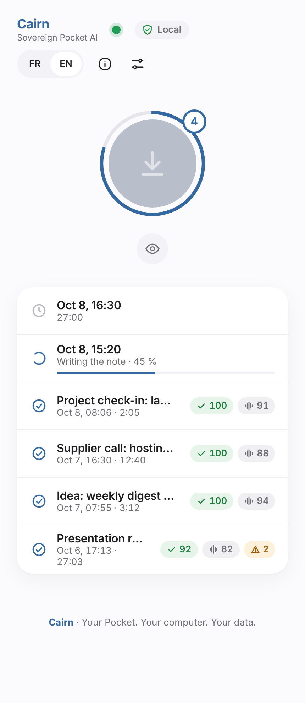 |  |

| Secure my Pocket | A Pocket that is protected | Who said what |
|---|---|---|
| 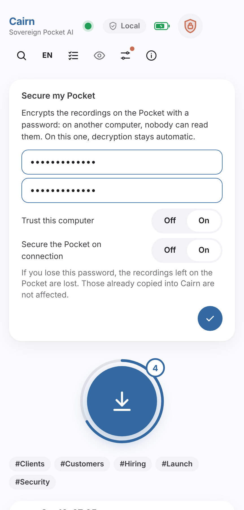 | 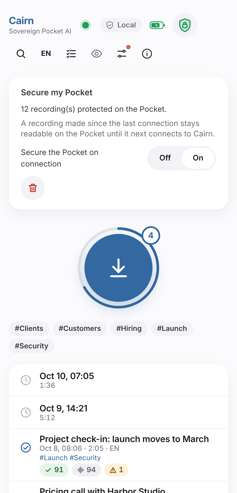 | 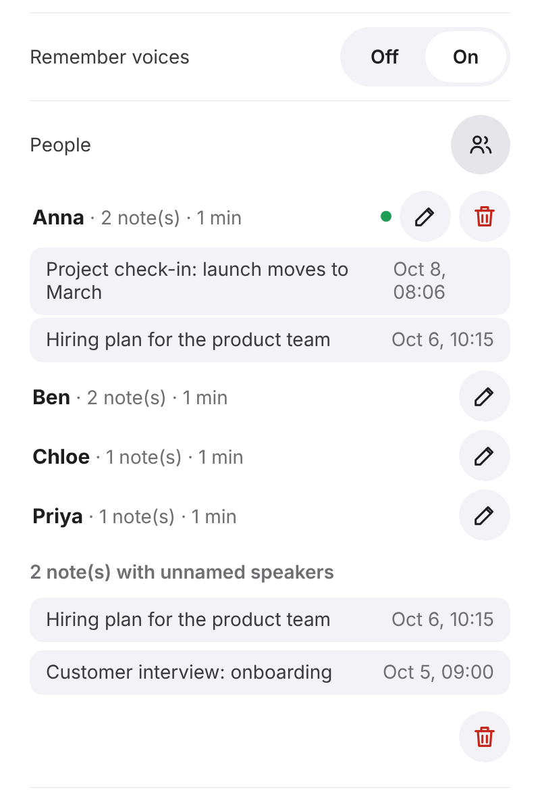 |

| Find anything | Ask your notes | Hear what was said |
|---|---|---|
| 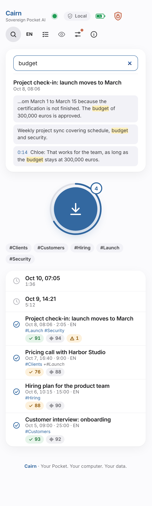 |  | 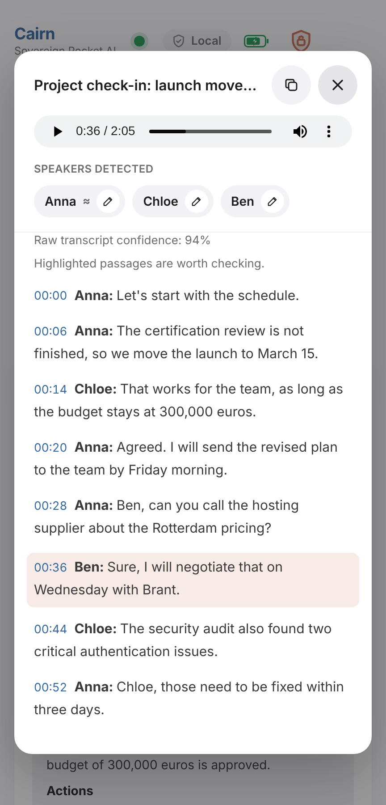 |

| Fix it in place | Words to check | Your vocabulary |
|---|---|---|
| 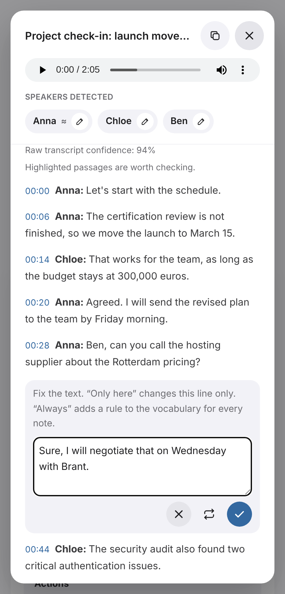 | 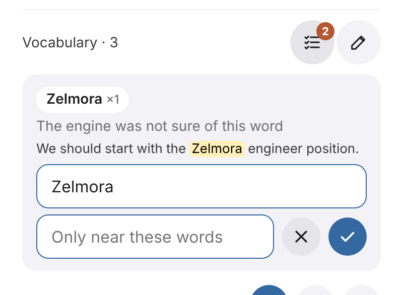 | 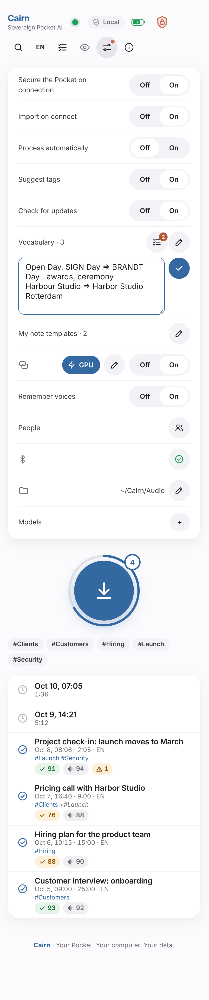 |

| Tags | All your actions | The follow-up email |
|---|---|---|
| 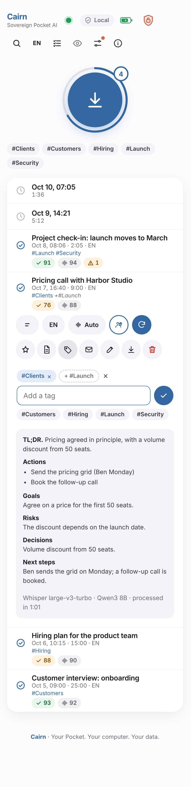 | 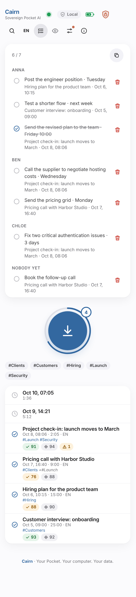 | 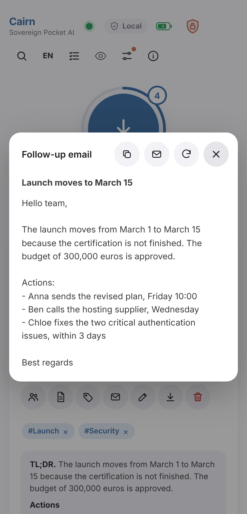 |

| Settings | Your note templates | Models on demand |
|---|---|---|
| 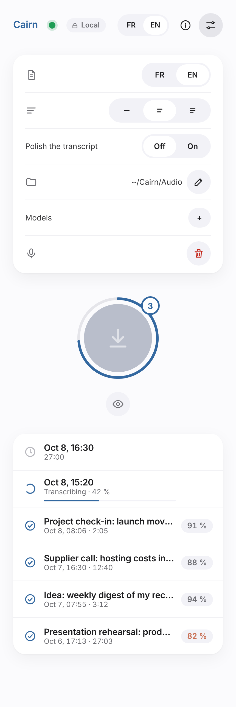 | 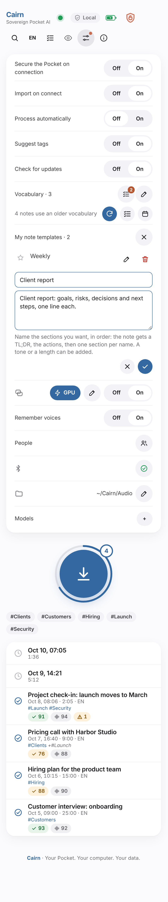 | 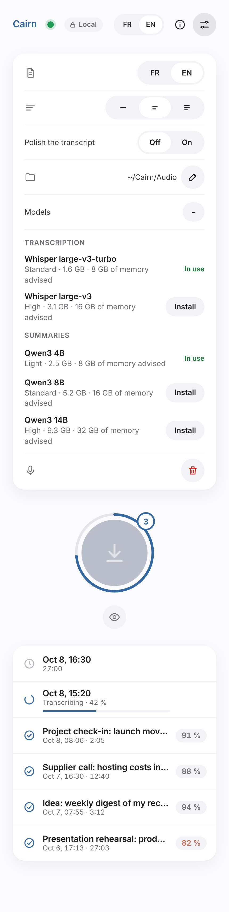 |

| About | Locked, with a password or Touch ID | Export to HTML (transcript folded) |
|---|---|---|
| 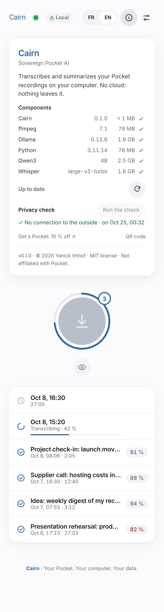 | 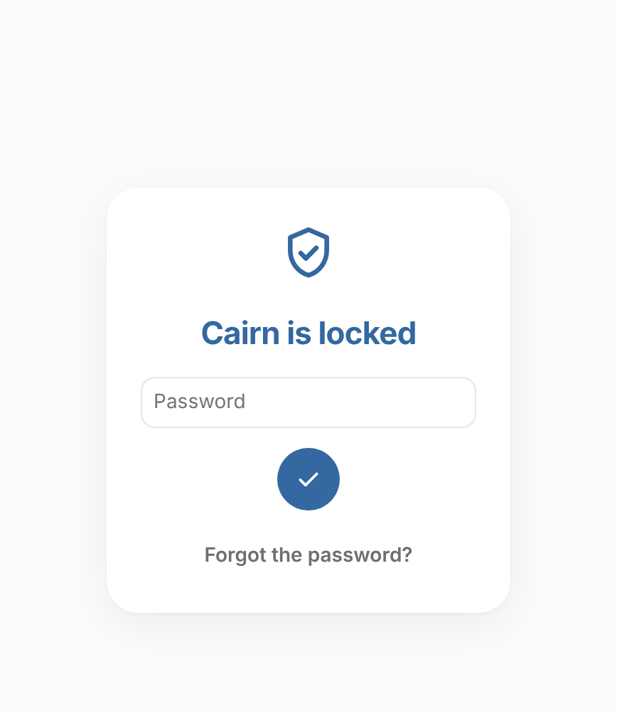 | 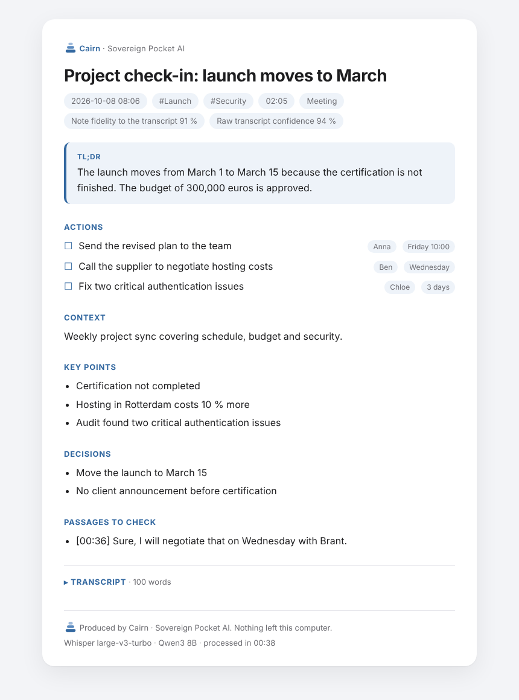 |

| Copy for an email |
|---|
| 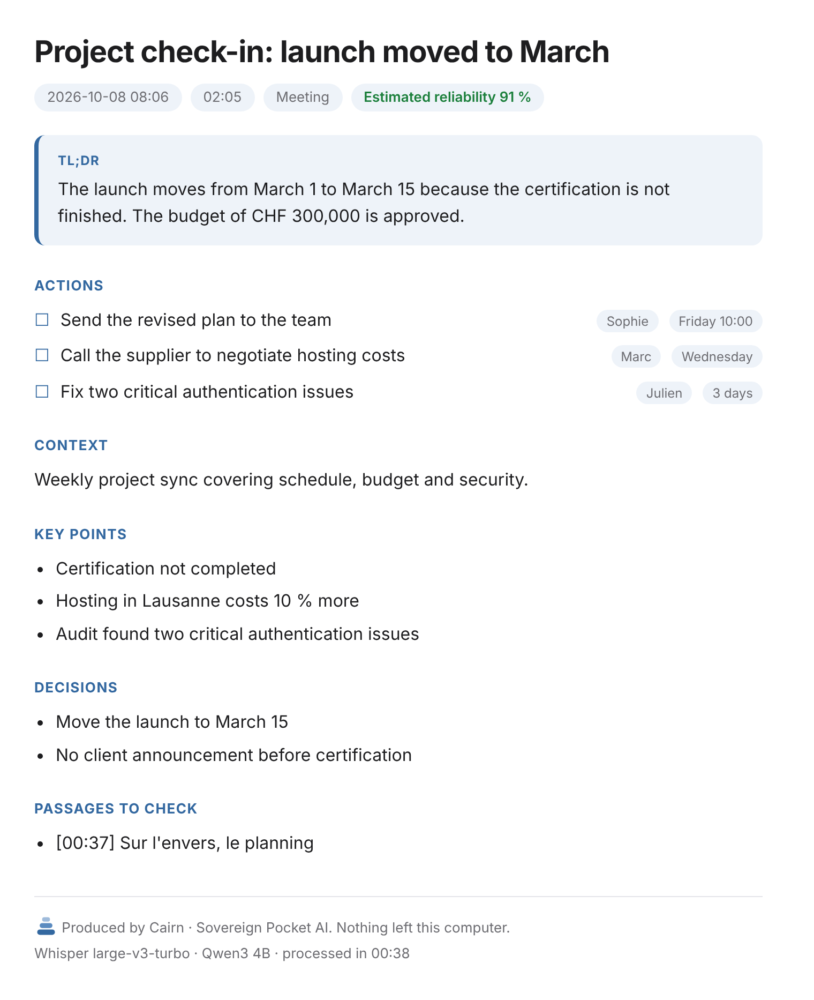 |

> **Status: v0.8.0, stable.** Runs in your browser, offline. Tested end to end on macOS (Apple silicon); Windows is checked in CI, not yet on real hardware; Intel Mac and Linux are untested. See the [release notes](docs/RELEASE-NOTES.md).

## Install

Cairn installs itself in one folder of your home folder (`~/Cairn`): no administrator rights, no system change, and nothing to install beforehand (no Homebrew, no Python). Every download, with its version and size, is listed in [SECURITY.md](SECURITY.md). Delete the folder to uninstall.

| | macOS | Windows |
|---|---|---|
| **Download** | [Cairn.dmg](https://github.com/yanickimhof/cairn_pocket_ai/releases/latest/download/Cairn.dmg): double-click Install Cairn, same guided installer | not yet |
| **One command** | Guided: reads your Mac and advises the models | Installs the Light models |
| **From a Git clone** | `bash install.sh` | `.\install.ps1` |

### macOS: the disk image

Download [Cairn.dmg](https://github.com/yanickimhof/cairn_pocket_ai/releases/latest/download/Cairn.dmg) (a few hundred KB; the models come afterwards), open it and double-click **Install Cairn**. It opens Terminal and runs the same guided installer as the command below. The app is not signed with an Apple developer certificate, so macOS asks once: on macOS 15 use System Settings, Privacy & Security, **Open Anyway**; on macOS 14 Control-click, Open. The page of the release gives the SHA-256 of the image.

### macOS: one command, guided

```
curl --proto '=https' --tlsv1.2 -fsSL https://raw.githubusercontent.com/yanickimhof/cairn_pocket_ai/v0.8.0/install.sh | bash
```

The installer looks at your Mac (chip, memory, free disk space), **advises a set of models and lets you choose**. Press Enter to take the advised one.

| Profile | Made for | Speech | Notes | Models to download |
|---|---|---|---|---|
| **Light** | 8 GB of memory | Whisper large-v3-turbo | Qwen3 4B | about 4.1 GB |
| **Standard** | 16 GB | Whisper large-v3-turbo | Qwen3 8B | about 6.8 GB |
| **High** | 32 GB or more | Whisper large-v3 | Qwen3 14B | about 12.4 GB |

A profile that does not fit your free disk space is not offered. The Python packages and the model server (if you do not already have Ollama) come in addition: about 4.8 GB in all for Light. Nothing is final: **Settings, Models** changes any model later, and an update keeps what you have unless you choose otherwise. Not sure which one? Take the advised one.

In a script or a test nothing is asked. `CAIRN_PROFILE=standard` picks a profile, `CAIRN_YES=1` never asks (it keeps what is installed, or takes Light), and `CAIRN_LLM` and `CAIRN_WHISPER_REPO` name the models yourself. All options: [docs/INSTALL.md](docs/INSTALL.md).

### From a Git clone

```
git clone https://github.com/yanickimhof/cairn_pocket_ai.git
cd cairn_pocket_ai
bash install.sh
```

The same installer, run from your copy: you can read the code before it runs, and `git pull` followed by the same command updates Cairn. On Windows, run `.\install.ps1` in PowerShell instead.

### Windows

```
irm https://raw.githubusercontent.com/yanickimhof/cairn_pocket_ai/v0.8.0/install.ps1 | iex
```

It installs the Light models. The guided choice of a profile is planned; until then, pick larger models afterwards in **Settings, Models**, or clone the repository as above.

### Before you start

| | Minimum | Recommended |
|---|---|---|
| Processor | 64-bit, 4 cores (Intel Mac or Windows PC: slower) | Apple silicon (M1 or later), or a recent 8-core PC |
| Memory | 8 GB | 16 GB or more (larger models) |
| Disk space | 12 GB free | 20 GB free (High profile: 18 GB at least) |
| System | macOS 14, Windows 10 22H2 | Latest version |
| Internet | Installation only: about 4.8 GB (Mac, Light), 7.5 GB (Standard), 13 GB (High), 7 GB (Windows); about 2.5 GB less if Ollama and the Qwen3 model are already installed (estimates) | |
| Pocket (optional) | A USB-C **data** cable | Audio files can be added without a Pocket |

No graphics card needed. Everything works offline once installed.

## Set up your Pocket (once)

In the Pocket mobile app, open the device settings, then:

1. Turn **on** USB Mode (Pocket Web Sync). It is off by default, and the USB-C port then only charges.
2. Turn **off** every automatic or cloud sync option (auto-sync, Wi-Fi or online sync, cloud backup and the like). Otherwise the Pocket sends recordings to Pocket's online service on its own, and the phone app then removes them from the drive, so Cairn never sees them. Option names vary between app versions.
3. Connect the Pocket with a USB-C **data** cable. A drive named `Pocket` appears, and the dot in Cairn turns green. If no drive appears, see [troubleshooting](docs/INSTALL.md#troubleshooting): Cairn can only read a Pocket that the computer already shows as an external drive. Close the Pocket desktop app if you use it, so that only one program reads the device.

You need neither the Pocket desktop app nor a Pocket account on the computer.

## Optional features

Each one is off until you turn it on, and works fully on your computer.

| Feature | What it gives you | Details |
|---|---|---|
| Other models | A larger speech or notes model, or Parakeet v3 (much faster in a single language); `cairn bench` measures them on your recordings | [Models](docs/GUIDE.md#models) |
| Ask your notes | A question in your own words, answered with the note and the minute behind it (needs a search model) | [Finding and asking](docs/GUIDE.md#finding-listening-following-up) |
| Speaker identification | Who speaks in the transcript and the note (needs a Hugging Face token) | [Speakers](docs/GUIDE.md#speaker-identification-diarization-optional) |
| Names and places | Your own spelling of names and rare terms, in every note | [Vocabulary](docs/GUIDE.md#names-and-places) |
| Lock and encryption | Notes, settings, index and recordings encrypted on this computer; password or Touch ID | [Lock](docs/GUIDE.md#lock-and-encryption) |
| Pocket battery and status (macOS) | Battery level, firmware, state and storage of the Pocket | [Pocket status](docs/GUIDE.md#pocket-status-macos-optional) |
| Menu bar (macOS) | A small icon that shows what Cairn is doing | [Menu bar](docs/GUIDE.md#menu-bar-macos) |

## Use it

1. Start Cairn: open `~/Cairn/Cairn.app` (macOS), the Start menu shortcut or `Cairn.cmd` (Windows), or run `~/Cairn/bin/cairn`. A page opens, served only by your computer and protected by a session key.
2. Connect your Pocket, or drop audio files on the page. Cairn copies and verifies the new recordings and lists them as waiting, so you see everything and decide what to process.
3. Press the central button (its badge counts what is waiting) to process the queue, or tap one recording. Cairn transcribes with Whisper, then titles and summarizes with a local model (a Qwen model through Ollama), at the level of detail, in the language and with the type you choose for each recording. Settings can import and process by themselves.
4. Each note shows two indicators, the fidelity of the note to its transcript and the speech engine's confidence in the raw transcript, and highlights the passages worth checking. Rename, tag, copy or export it (Markdown, HTML, to `~/Cairn/Exports`), tap a time stamp to hear the recording from that line, or write the follow-up email.
5. The magnifier searches every note (`#tag` filters). Press Enter to ask a question instead: the answer comes with the passages it is drawn from. The checklist icon gathers all your actions in one list.
6. Delete a recording when you no longer want it: it goes from the Pocket and from your computer in one step, for good, because the Pocket has no protection of its own.

Models, speed, background mode, web app and other details: [docs/GUIDE.md](docs/GUIDE.md). Install options, update and troubleshooting: [docs/INSTALL.md](docs/INSTALL.md).

## How it is checked

Every change runs through automated checks on GitHub: unit and end-to-end tests, a test that loads and drives the page script, static analysis of the code, a scan for secrets, and a complete installation on macOS and Windows, from a simulated Pocket to an exported note. The install commands point at a fixed release, packages are pinned by hash, speech models by revision, and Dependabot watches the dependencies. The interface goes through automated accessibility checks (axe-core) and a keyboard walk; it has not been tested with a screen reader yet. Details and known limits: [SECURITY.md](SECURITY.md).

## Why sovereign

- Audio, transcripts and summaries stay on your computer, and the models are open and swappable.
- No outgoing connection in everyday use, apart from an optional daily look for a new version. A network guard blocks the rest, and a privacy check runs by itself every day: the shield next to **Local** shows the result.
- Nothing is reachable from the network: the app and the model server answer only on `127.0.0.1`, your computer talking to itself.

How to verify it yourself: [docs/PRIVACY.md](docs/PRIVACY.md). Every download, with versions and sizes: [SECURITY.md](SECURITY.md).

## Buying a Pocket

Cairn is free and works with any Pocket you already own. To buy one, use the official site, [heypocket.com](https://heypocket.com). The maintainer's [referral link](https://referral.heypocketai.com/refer/39179caf?source=desktop_copy) is optional: it is Pocket's own programme, so the offer (10% off at the time of writing) is set by Pocket alone and can change or end at any time. If you use it, the maintainer receives a reward from Pocket at no cost to you. Cairn works the same either way.

## Disclaimer

Cairn is an independent, unofficial project, **not affiliated with, endorsed by or sponsored by Pocket** ([heypocket.com](https://heypocket.com)), a product of Open Vision Engineering Inc. "Pocket" and "Pocket AI" belong to their owners. Cairn uses these names only to say which device it works with, includes none of their logos or assets, and reads the files the device exposes in USB mode.

Make sure you have the right, and the consent where required, to record and process conversations.

## License

MIT, see [LICENSE](LICENSE). Third-party components keep their own licenses, see [NOTICE](NOTICE). Copyright (c) 2026 Yanick Imhof.
