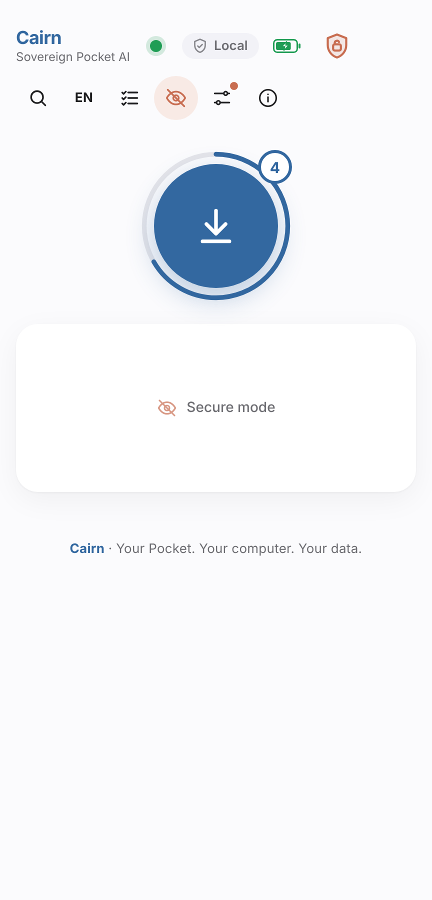
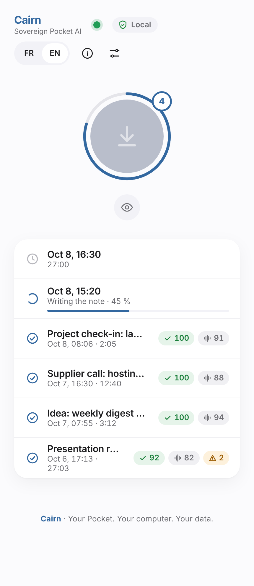
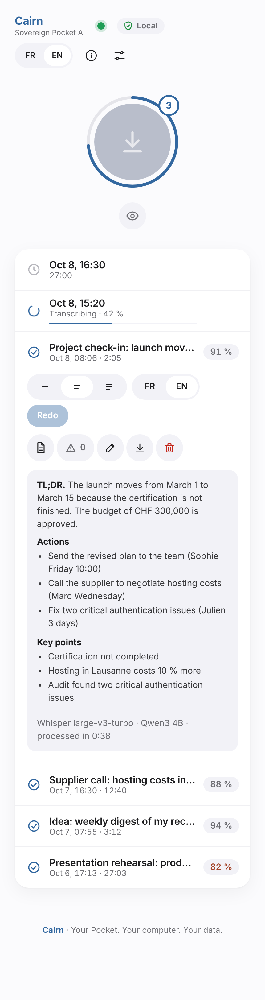
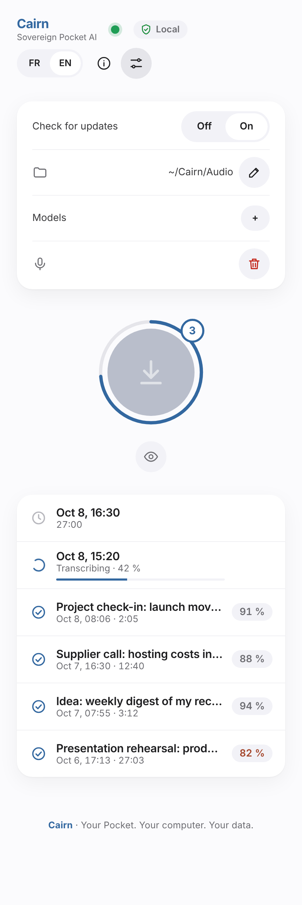
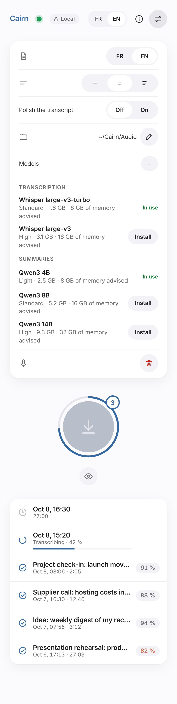
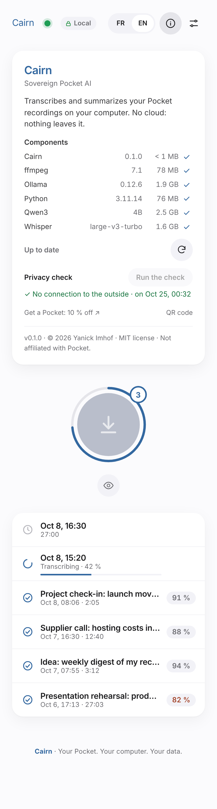
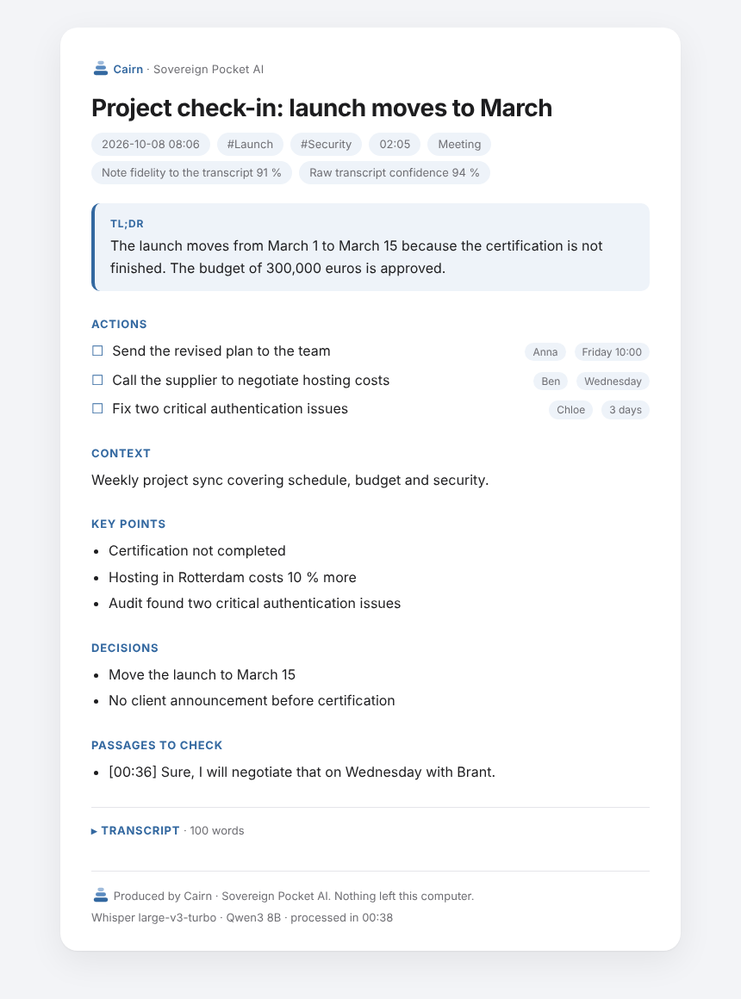
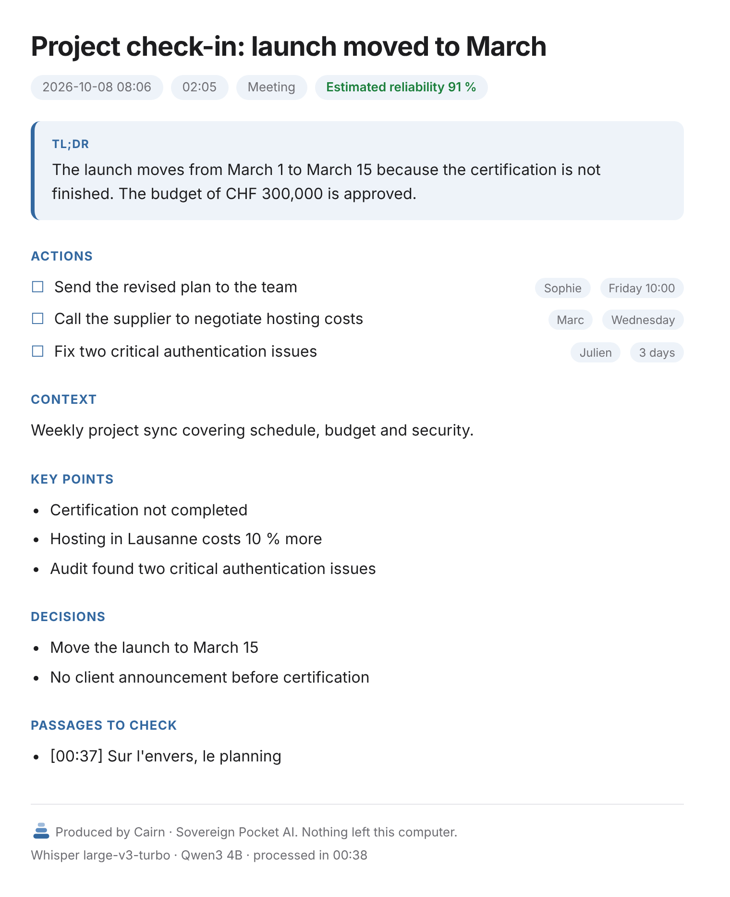

# Cairn

**Your Pocket. Your computer. Your data.**

Sovereign Pocket AI. Turn your Pocket recordings into clean, structured notes, entirely on your computer.

No cloud, no account, no telemetry. Nothing leaves your machine.

*A cairn is a stack of stones that marks a trail. This one marks the way from your voice to your notes.*

| Secure by default | Your recordings | Your notes |
|---|---|---|
|  |  |  |

| Settings | Models on demand | About |
|---|---|---|
|  |  |  |

| Export to HTML (transcript folded) | Copy for an email |
|---|---|
|  |  |

> **Status: v0.1, preview.** Runs in your browser, offline. Tested end to end on macOS; Windows is checked in CI. See the [roadmap](docs/ROADMAP.md).

## Install

Paste one command in a terminal. It detects your system and installs everything in your own folder: no administrator rights, no system change. Not sure which one? The [install page](https://yanickimhof.github.io/cairn_pocket_ai/) shows the right command and the download sizes.

bash or zsh:

```
curl --proto '=https' --tlsv1.2 -fsSL https://raw.githubusercontent.com/yanickimhof/cairn_pocket_ai/main/install.sh | bash
```

PowerShell:

```
irm https://raw.githubusercontent.com/yanickimhof/cairn_pocket_ai/main/install.ps1 | iex
```

| | Minimum | Recommended |
|---|---|---|
| Processor | 64-bit, 4 cores (Intel Mac or Windows PC: slower) | Apple silicon (M1 or later), or a recent 8-core PC |
| Memory | 8 GB | 16 GB or more (larger models) |
| Disk space | 12 GB free | 20 GB free |
| System | macOS 14, Windows 10 22H2 | Latest version |
| Internet | Installation only: about 5.5 GB (Mac) or 7 GB (Windows), about 2.5 GB if Ollama and a Qwen3 model are already installed | |

No graphics card needed. Everything works offline once installed.

## Set up your Pocket (once)

In the Pocket mobile app, open the device settings, then:

1. Turn **on** USB Mode (Pocket Web Sync). It is off by default, and the USB-C port then only charges.
2. Turn **off** every automatic or cloud sync option (auto-sync, Wi-Fi or online sync, cloud backup and the like). Otherwise the Pocket sends recordings to Pocket's online service on its own, and the phone app then removes them from the drive, so Cairn never sees them. Option names vary between app versions.
3. Connect the Pocket with a USB-C **data** cable. A drive named `Pocket` appears, and the dot in Cairn turns green. If no drive appears, see [troubleshooting](docs/INSTALL.md#troubleshooting): Cairn can only read a Pocket that the computer already shows as an external drive. Close the Pocket desktop app if you use it, so that only one program reads the device.

You need neither the Pocket desktop app nor a Pocket account on the computer.

## Use it

1. Start Cairn: open `~/Cairn/Cairn.app` (macOS), the Start menu shortcut or `Cairn.cmd` (Windows), or run `~/Cairn/bin/cairn`. A page opens, served only by your computer and protected by a session key.
2. Click **Import**. Cairn copies and verifies every recording.
3. It transcribes each one with Whisper, then titles and summarizes it with a local model (Qwen3 through Ollama), at a level of detail and in a language that you choose for each recording. Each note carries a reliability score and flags the passages worth checking.
4. Rename, copy or export a note (Markdown, HTML). Exports go to `~/Cairn/Exports`.
5. Optionally empty the Pocket, only after every copy is verified.

Models, speed, background mode, web app and other details: [docs/GUIDE.md](docs/GUIDE.md). Install options, update and troubleshooting: [docs/INSTALL.md](docs/INSTALL.md).

## Why sovereign

- Audio, transcripts and summaries stay on your computer, and the models are open and swappable.
- No outgoing connection in everyday use, apart from an optional daily look for a new version. A network guard blocks the rest, and a privacy check runs by itself every day: the shield next to **Local** shows the result.
- Nothing is reachable from the network: the app and the model server answer only on `127.0.0.1`, your computer talking to itself.

How to verify it yourself: [docs/PRIVACY.md](docs/PRIVACY.md). Every download, with versions and sizes: [SECURITY.md](SECURITY.md).

## Buying a Pocket

Cairn is free and works with any Pocket you already own. To buy one, use the official site, [heypocket.com](https://heypocket.com). The maintainer's [referral link](https://referral.heypocketai.com/refer/39179caf?source=desktop_copy) is optional: it is Pocket's own programme, so the offer (10% off at the time of writing) is set by Pocket alone and can change or end at any time. If you use it, the maintainer receives a reward from Pocket at no cost to you. Cairn works the same either way.

## Disclaimer

Cairn is an independent, unofficial project, **not affiliated with, endorsed by or sponsored by Pocket** ([heypocket.com](https://heypocket.com)), a product of Open Vision Engineering Inc. "Pocket" and "Pocket AI" belong to their owners. Cairn uses these names only to say which device it works with, includes none of their logos or assets, and reads the files the device exposes in USB mode.

Make sure you have the right, and the consent where required, to record and process conversations.

## License

MIT, see [LICENSE](LICENSE). Third-party components keep their own licenses, see [NOTICE](NOTICE). Copyright (c) 2026 Yanick Imhof.
